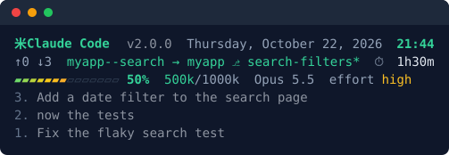
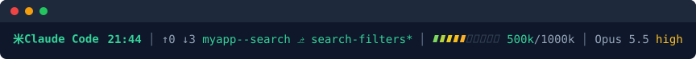

<h1 align="center">statmine</h1>

<p align="center">A Claude Code statusline that shows where a commit will land, how full your context is, and what you just asked for.</p>

<p align="center">
  <a href="https://github.com/eStudio37/statmine/actions/workflows/test.yml"></a>
  <a href="LICENSE"></a>
</p>

The full view:

<p align="center"></p>

The compact view, on one line:

<p align="center"></p>

Both images are the real output of `scripts/statusline.sh` for a sample session, made by `bash tools/render-demo.sh`.

<details>
<summary>The same views as text</summary>

```text
米Claude Code  v2.0.0  Thursday, October 22, 2026  21:44
↑0 ↓3  myapp--search → myapp ⎇ search-filters*  ⏱ 1h30m
▰▰▰▰▰▰▰▱▱▱▱▱▱▱ 50%  500k/1000k  Opus 5.5  effort high
3. Add a date filter to the search page
2. now the tests
1. Fix the flaky search test
```

```text
米Claude Code 21:44 │ ↑0 ↓3 myapp--search ⎇ search-filters* │ ▰▰▰▰▰▱▱▱▱▱ 500k/1000k │ Opus 5.5 high
```

</details>

## Features

- **Where a commit lands.** Folder, repo and branch. Green when they agree. Amber when a `<repo>--<name>` worktree folder has another branch checked out, or HEAD is detached. Red when a commit would land in a different repo than the session's.
- **Commit counts.** Unpushed (`↑`) and branch-only (`↓`), with `⊘` when there is no remote or nothing committed yet.
- **Context.** Window use as a bar and a percent, tokens, model and reasoning effort.
- **Your last three requests.** Only what you typed. Long prompts get a one-line summary, which you can turn off.
- **Two views.** A full view of several rows, or a compact view on one line.
- **Private and local.** Your data stays on your machine, readable only by you. The one exception is the optional summary: your own `claude` CLI sends long prompts to the summary model. Turn summaries off and nothing leaves your machine.
- **Fail-soft.** A missing tool or file hides its part of the statusline, and Claude Code keeps running.

## Requirements

- Claude Code with plugin support.
- `bash`, `jq` and `git` 2.31 or later.
- [Bun](https://bun.sh) 1.3.6 or later on your `PATH`, for the request rows. The hook needs its `--no-env-file` flag.
- The `claude` CLI on your `PATH`, for summaries (optional).
- Linux and WSL. macOS has not been tested.

## Install

Run each line as its own prompt in Claude Code:

```
/plugin marketplace add eStudio37/statmine
```

```
/plugin install statmine@statmine
```

Then `/reload-plugins` (or restart) and:

```
/statmine:setup
```

Setup backs up `~/.claude/settings.json` and points your statusline at statmine. It asks before replacing an existing one. A plugin cannot set the statusline by itself, so this step is needed once.

Update with `claude plugin update statmine@statmine`. To uninstall, run `/plugin uninstall statmine@statmine`, then remove `statusLine` from `~/.claude/settings.json` or restore the backup. Otherwise Claude Code keeps trying to run a script that is gone. See [Update and uninstall](docs/user-guide.md#update-and-uninstall).

## Use

The statusline redraws on every event and every 10 seconds. The full view is the default. Switch views at any time:

```
/statmine:mode compact
/statmine:mode full
/statmine:mode
```

The last one prints the current view. A switch shows within 10 seconds.

Options are in `/plugin configure statmine@statmine`, or under statmine in `/config`:

| Option | Default | What it does |
|---|---|---|
| Header label | `米Claude Code` | Text at the start of both views. Leave it empty for none. A new label shows from the next session. |
| Summarize long requests | on | Asks a small model for a one-line summary of prompts too long for a row. |
| Summary model | `haiku` | Any value `claude --model` accepts. |

The [user guide](docs/user-guide.md) explains every part of both views.

## What statmine can access

statmine runs as you, with your permissions. This is everything it touches:

- **Reads:** the JSON Claude Code passes to the statusline (session id, folders, model, effort, session time, context use) and to the prompt hook (session id and the prompt you typed). Its own data folder. The git state of the session's folders: repo, branch, uncommitted changes, and commit counts from local refs. statmine opens none of your project files itself. `/statmine:setup` reads `~/.claude/settings.json`.
- **Writes:** its data folder, `~/.claude/plugins/data/statmine-statmine/`, created `0700` with files `0600`. It holds the prompts you typed, one line each, cut to 200 characters and kept 7 days; the last 200 summaries; a copy of the statusline script; your label and the version; and the view. Channel wrappers, which carry chat ids, are removed before anything is written. Only when you run `/statmine:setup`, it also copies `~/.claude/settings.json` to `settings.json.statmine-backup-<time>` and then sets the `statusLine` key in it.
- **Runs:** `bash`, `jq`, `git` and standard shell tools for the statusline. `bun` for the prompt hook and the summary worker. With summaries on, your own `claude` CLI for each prompt longer than a row, with no tools and no setting sources. The prompt text reaches it through a private file and stdin, never the command line.
- **Network:** statmine's own code opens no network connections, and it never runs `git fetch`. The only network use is the optional summary: the `claude` CLI it starts sends the prompt to the summary model on your own account. With summaries off, statmine sends nothing anywhere.
- **Dependencies:** none beyond the tools under [Requirements](#requirements) and Bun's built-in modules. The plugin uses no npm packages. The ones in `package.json` are development tools only.

[How it works](docs/how-it-works.md#security-and-privacy) has the details.

## Troubleshooting

- **The statusline did not change.** Run `/statmine:setup`. Installing the plugin alone does not change the statusline.
- **It says "install jq".** Install `jq` with your package manager.
- **There are no request rows.** Check that Bun 1.3.6 or later is on your `PATH` (`bun --version`). A Bun without the `--no-env-file` flag fails the hook on every prompt. Rows show prompts typed in the current session only.
- **Long prompts never get a summary.** Check that summaries are on, and that `claude` is on your `PATH` or `CLAUDE_BIN` holds its absolute path.

More cases, and how to run the script by hand, are in the [user guide](docs/user-guide.md#troubleshooting).

## Development

```sh
bun install               # pinned dev tools: TypeScript and Bun types
bun test tests            # black-box tests
bun run typecheck         # tsc --noEmit
bun run lint              # shellcheck on every .sh file
claude plugin validate .  # manifest, marketplace and directory checks
claude --plugin-dir .     # a session with this checkout loaded
```

The tests run the real scripts with a temporary data folder, temporary git repositories and a stub in place of `claude`. They never call a real model. See [CONTRIBUTING.md](CONTRIBUTING.md).

## Documentation

- [User guide](docs/user-guide.md): reading every part of the statusline, options, your data, troubleshooting, update and uninstall.
- [How it works](docs/how-it-works.md): design, data flow, file formats, rules, security properties, limits, development and releases.
- [Changelog](CHANGELOG.md): what changed in each release.

## License

[MIT](LICENSE)
